  

  
  
  

I'm a software engineer from **Moldova**, based in **Vienna**, focused on AI. I spent nine months in the IT Development department of the **Austrian National Bank (OeNB)**, building LLM and speech systems for confidential data, and I wrote my BSc thesis on how to evaluate LLMs properly.

I like taking an idea from the first prototype to software that runs reliably for real users, whether that's a backend service, a data pipeline or an LLM-powered feature.

---

### Experience

**AI/ML Engineer Intern, Austrian National Bank (OeNB)** · Vienna, 2024–2025

- Built a speech-to-text pipeline for Austrian German on my own, based on Whisper.
- Helped build an internal LLM chatbot for confidential bank data. I rebuilt how it searches its documents, which roughly tripled the number of correct answers.
- Built the chatbot's guardrails together with a teammate, so its answers cite their sources.

**2nd place, ZERO ONE HACK 2026** · AI in Industry track

AI Factory Austria's largest hackathon, with 100+ participants. In 36 hours our team trained a GPT-style model from scratch to model semiconductor processes, with runs on the Leonardo supercomputer.

---

### Featured: my BSc thesis

**Frameworks and Metrics for Evaluating LLMs** · BSc Informatics with distinction, IMC Krems, 2025

I benchmarked GPT-2, Llama 3.1 8B and GPT-4o-mini on **~36,000 outputs** across translation, question answering and summarisation, scored with 10 metrics (one of them my own). From the results I built **MTEF**, my own framework for evaluating large language models.

---

### Tech stack

  
  
  
  
  
  
  
  
  

  
  
  
  
  
  
  
  
  

  
  
  
  
  
  

Also on my GitHub: <a href="https://github.com/cristianvortolomei/Scout-and-Scribe">Scout & Scribe</a>, a local research assistant that writes cited briefs from PDFs and web pages.

---

### Get in touch

I'm doing a part-time MSc in Engineering Responsible AI Systems and can work **up to 32 h/week**. I'm looking for **student jobs and junior roles** in AI and software engineering.

[cristianvortolomeicode@gmail.com](mailto:cristianvortolomeicode@gmail.com) · [LinkedIn](https://www.linkedin.com/in/cristianvortolomei) · Discord: `cristicode`
